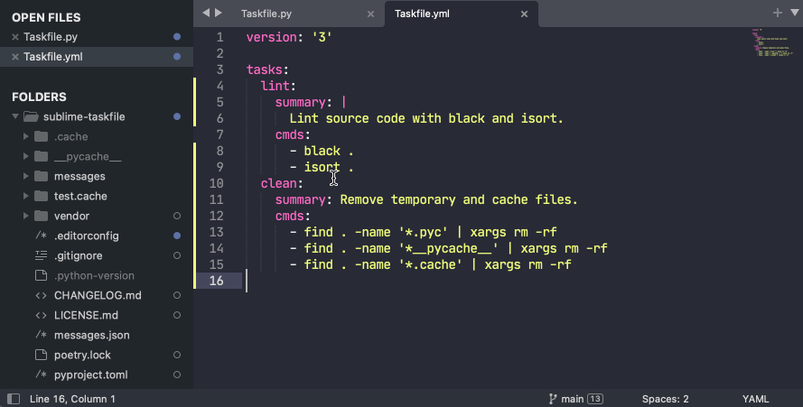

# Sublime Taskfile


A Sublime Text 4 plugin for running tasks from [Taskfile](https://taskfile.dev). It adds `Taskfile: Run Task` to your command palette and you can select which task to run. The output of the task is then displayed in the build output panel at the bottom.

It is also possible to initialize the `Taskfile` with `Taskfile: Init` command, which basically does `task -i` in one of the project directories you choose.



- made for Sublime Text 4, including the Python 3.14 plugin host
- has no external dependencies (other than `task` command)
- properly handles multiple open directories
- supports taskfile includes
- does not and will not ship any custom syntax definitions (see installation notes for more details)

## Installation

First, [install Taskfile command](https://taskfile.dev/installation/).

Then use `Package Control: Install Package` command and search for `Taskfile`.

If you want to have a hints on which keys are available and what they do, there is an [official JSON schema for Taskfile](https://json.schemastore.org/taskfile.json), which can be loaded automatically once you install [LSP](https://packagecontrol.io/packages/LSP) and [LSP-yaml](https://packagecontrol.io/packages/LSP-yaml) packages.

## Compatibility

Supports Python 3.8 through 3.14. Sublime Text supplies its own Python runtime;
you do not need to install Python to use this plugin. Sublime Text 4213 and newer
ship Python 3.14, replacing Python 3.8.

The package deliberately keeps `.python-version` set to `3.8`: Sublime Text maps
this to Python 3.14 on new builds and Python 3.8 on older Sublime Text 4 builds.
See the [Sublime Text API environments documentation](https://www.sublimetext.com/docs/api_environments.html).

Task must be available on Sublime Text's `PATH`. The plugin recognizes `.yml`,
`.yaml`, lowercase and `.dist` Taskfile names in open project folders.

## Contributing

You are welcome to submit pull requests with bug fixes and improvements.

Use Python 3.10 or newer for development tooling (Python 3.14 recommended).
The `.python-version` file selects Sublime's plugin host, so explicitly select
your development interpreter when using tools such as pyenv or uv.

```sh
poetry env use python3.14
poetry install --no-root
poetry run python -m unittest discover -s tests -v
poetry run black .
poetry run isort .
poetry run autoflake --check --recursive Taskfile.py tests
```

CI tests Python 3.8–3.14 on Linux, macOS and Windows using a stub of the Sublime
API. Changes to editor behavior should also be checked inside Sublime Text.

For releases, update the version in `pyproject.toml` and add a dated entry to
`CHANGELOG.md`. Use that entry for the GitHub release description. Reserve
Package Control upgrade messages for breaking changes, migration steps or other
changes requiring user attention; routine fixes only need release notes.
